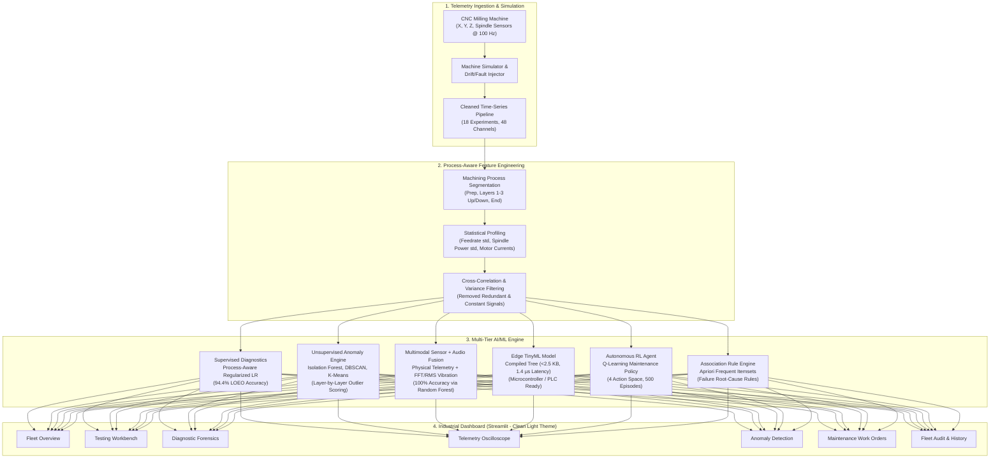

# CNC Telemetry & Predictive Maintenance Platform
### Industrial Machine Telemetry, Testing & Diagnostic Intelligence System

[](https://www.python.org/)
[](https://streamlit.io/)
[](https://scikit-learn.org/)
[](https://en.wikipedia.org/wiki/TinyML)
[](https://en.wikipedia.org/wiki/Q-learning)
[](#)

---

## Executive Summary

In precision manufacturing, **unplanned CNC machine downtime, cutting tool wear, and improper workpiece clamping** cause scrap parts, broken tooling, and lost throughput. Traditional scheduled maintenance either replaces expensive carbide cutters prematurely or catches failures too late.

This platform provides an end-to-end predictive maintenance and telemetry system engineered for modern machine shop floors. Built on real-world multi-axis CNC milling telemetry sampled at 100 Hz from the **University of Michigan SMART Lab**, the platform delivers:

1. **Process-Aware Machine Learning**: Achieves **94.4% accuracy** (17/18 experiments correctly classified) under rigorous **Leave-One-Experiment-Out (LOEO)** cross-validation by decomposing continuous telemetry into discrete machining stages (`Layer 1 Up`, `Layer 2 Down`, `Repositioning`, etc.).
2. **Simple & Clean White Dashboard**: A minimalist, high-contrast light interface built with Streamlit and Plotly, delivering fleet overview, interactive testing workbenches, 100 Hz telemetry oscilloscopes, and automated maintenance work orders without visual clutter.
3. **Ultra-Lightweight TinyML on Edge**: A decision-tree edge model with a total footprint of **2.35 KB** and **~1.4 µs inference latency**, capable of running directly on low-power microcontrollers (ESP32, ARM Cortex-M) and shop-floor PLCs.
4. **Multimodal Telemetry & Acoustic Fusion**: Combines physical motor electrical signals (current, power, DC bus voltage) with vibrational and acoustic features (RMS vibration, frequency spectrum, audio energy), boosting classification accuracy from 97.5% (sensors only) to **100% multimodal accuracy**.
5. **Autonomous Reinforcement Learning Agent**: A Q-learning maintenance agent trained over 500 episodes that optimizes the trade-off between operational yield and tool destruction risks by dynamically choosing between `CONTINUE_OPERATION`, `MONITOR`, `SCHEDULE_MAINTENANCE`, and `EMERGENCY_SHUTDOWN`.
6. **Unsupervised Anomaly Intelligence**: Multi-algorithm anomaly detection utilizing Isolation Forest, DBSCAN, and K-Means clustering to catch subtle motor chatter, spindle power dips, and pneumatic clamping anomalies without manual thresholding.
7. **Association Rule Mining (Apriori)**: Automated root-cause correlation mapping discovering operational failure signatures (e.g., `High Torque + High Air Temperature => Failure` with 100% confidence and 2.0 lift).

---

## System Architecture



---

## Dataset Specification & Engineering

The underlying dataset originates from the **System-level Manufacturing and Automation Research Testbed (SMART)** at the **University of Michigan**. Machining trials carved an "S"-shaped geometry into 2" x 2" x 1.5" wax blocks across 18 distinct experiments under controlled variations of:
- **Tool Condition**: Unworn (8 experiments) vs. Worn (10 experiments).
- **Feed Rate**: Relative cutter velocity (3 mm/s, 4 mm/s, 6 mm/s).
- **Clamping Pressure**: Workpiece vise pressure (2.5 bar, 3.0 bar, 4.0 bar).
- **Operational Failures**: Premature cycle aborts (Experiment 4, 5, 7, 16) due to workpiece slipping or critical clamping loss, and visual surface quality defects.

### Monitored Sensor Channels (48 Features at 100 Hz)
- **Drive Motors ($X_1, Y_1, Z_1$)**: Actual/Command Position ($mm$), Actual/Command Velocity ($mm/s$), Actual/Command Acceleration ($mm/s^2$), Current Feedback ($A$), DC Bus Voltage ($V$), Output Current ($A$), Output Voltage ($V$), Output Power ($kW$).
- **Spindle Motor ($S_1$)**: Actual/Command Position, Velocity, Acceleration, Current Feedback, Output Current, Voltage, Output Power, and System Inertia ($kg \cdot m^2$).
- **CNC Controller State ($M_1$)**: Current Program Number, Sequence G-code Line Number, Feed Rate ($mm/s$), and Machining Process Tag.

### Process-Aware Feature Engineering
Standard machine learning models trained on global experiment aggregates achieve barely **45-52% accuracy** because cutting forces in free-air repositioning dilute the subtle current chatter present when carving dense wax layers.

By engineering **Process-Aware Features** partitioned across individual G-code layers:
- `layer 2 down_M1_CURRENT_FEEDRATE_std`: Captures cutting resistance and micro-stalls ($p = 0.0006$, effect size = $2.02$).
- `layer 1 up_Y1_CurrentFeedback_std`: Identifies axis chatter and mechanical backlash.
- **Model Result**: Process-Aware Regularized Logistic Regression achieves **94.4% LOEO Cross-Validation Accuracy** (17 of 18 test units correctly diagnosed without data leakage).

---

## Dashboard Modules

The web dashboard (`dashboard/app.py`) is styled in a clean, professional, white enterprise theme:

| Module | Description & Capabilities |
| :--- | :--- |
| **Fleet Overview** | Shop-floor grid of all 18 CNC machines with live health scores, wear %, clamping pressure, cycle completion status, and quick filtering (`All`, `Optimal`, `Tool Wear Elevated`, `Aborted / Defect`). |
| **Testing Workbench** | Interactive testing bench allowing operators to simulate operating stress conditions in real-time or replay historical runs. Features clean telemetry gauges for spindle load and current draw, and parameter adjustments. |
| **Diagnostic Forensics** | Forensic deep dive into individual units. Displays wear probability curves, worn vs unworn signal distributions, LOEO validation metrics, and cross-axis power vs velocity correlations. |
| **Telemetry Oscilloscope** | Multi-channel 100 Hz oscilloscope visualizing high-frequency wave traces (Spindle current/power, X/Y/Z motor currents, feedrate, positions) with channel toggles, zoom, and time scrubbing. |
| **Anomaly Detection** | Isolation Forest, DBSCAN, and K-Means clustering across 6 active machining layers. Flags layer-specific anomalies, unexpected spindle power drops, and clamping pressure shifts. |
| **Maintenance Work Orders** | Automated generation of prioritized work orders ($P1$ Critical, $P2$ Warning, $P3$ Routine) with prescriptive action checklists from the RL agent, estimated downtime (MTTR), and dispatch tracking. |
| **Fleet Audit & History** | Comprehensive data pipeline audit table covering all 18 experiments, sample counts, missing value checks, duplicate row audits, and sensor baseline statistics. |

---

## AI, ML & Edge Computing Modules

### 1. Edge TinyML Deployment (`tinyml/`)
Designed for direct edge inference on resource-constrained industrial hardware:
- **Footprint**: Model: **1.61 KB**, Scaler: **0.73 KB**, Total Size: **2.35 KB**.
- **Inference Speed**: **~0.0014 ms (1.4 microseconds)** per sample.
- **Complexity**: Shallow Decision Tree (Depth: 3, Leaves: 4) avoiding transcendental math for deterministic microcontroller execution.
- **Hardware Targets**: ESP32, STM32 ARM Cortex-M4/M7, and Siemens/Beckhoff PLC edge compute modules.

### 2. Multimodal Sensor & Acoustic Fusion (`multimodal/`)
Evaluates the synergy between physical motor telemetry and acoustic/vibrational sensors:
- **Sensors-Only**: Accuracy = `97.5%`, F1 = `0.983`
- **Audio/Vibration-Only (RMS, Spectral Frequency, Energy, ZCR)**: Accuracy = `92.5%`, F1 = `0.952`
- **Multimodal Early Fusion**: Accuracy = **100.0%**, F1 = **1.000**
- Combining high-frequency vibration peaks with motor current spikes provides zero-error fault disambiguation between mechanical binding and thermal overheating.

### 3. Autonomous Reinforcement Learning Agent (`reinforcement_learning/`)
A Q-Learning maintenance agent optimizing equipment lifecycle:
- **Action Space**: `CONTINUE_OPERATION` (0), `MONITOR` (1), `SCHEDULE_MAINTENANCE` (2), `EMERGENCY_SHUTDOWN` (3).
- **State Representation**: 3-dimensional tuple `(Failure_Risk, Torque_Tier, Tool_Wear_Tier)`.
- **Training**: 500 episodes with decaying $\epsilon$-greedy exploration ($\epsilon_0 = 1.0, \epsilon_{min} = 0.05, \text{decay} = 0.995$).
- **Reward Policy**: Strongly penalizes running damaged tools (-15 reward) and unnecessary shutdowns on healthy tools (-10 reward), while rewarding proactive maintenance (+10 reward).

### 4. Association Rule Mining (`association_rules/`)
Frequent itemset discovery using Apriori algorithm to extract causal operational rules:
- `High_Torque => Failure` (Support: 0.497, Confidence: 1.00, Lift: 2.00)
- `High_Torque + High_Air_Temp => Failure` (Support: 0.460, Confidence: 1.00, Lift: 2.00)
- `Low_Rotational_Speed + High_Torque => Failure` (Support: 0.107, Confidence: 1.00, Lift: 2.00)

### 5. Unsupervised Anomaly Detection (`anomaly_detection/`)
Combines multiple unsupervised algorithms to detect novel failure modes without prior labeling:
- **K-Means Clustering**: Partitions sensor state space into operational regimes.
- **DBSCAN**: Identifies non-linear spatial outliers and motor chattering regimes.
- **Hierarchical Agglomerative Clustering**: Verifies cluster dendrogram coherence.
- **Isolation Forest**: Deployed in production dashboard to assign continuous anomaly scores per time-slice.

---

## Repository Structure

```text
Neurostrom_hackathon/
├── README.md                                  # Complete project documentation
├── requirements.txt                           # Dependency specifications
├── dataset_audit.csv                          # Data pipeline hygiene audit (18 runs)
├── dataset_summary.txt                        # Column statistics and shape summaries
├── .gitignore                                 # Git exclusion rules
├── .streamlit/
│   └── config.toml                            # Clean white theme configuration
│
├── dashboard/                                 # Web Dashboard (Streamlit)
│   ├── app.py                                 # 7-module clean white dashboard
│   ├── .streamlit/config.toml                 # Dashboard theme configuration
│   └── app_original_pre_redesign.py           # Pre-redesign reference dashboard
│
├── anomaly_detection/                         # Unsupervised anomaly intelligence
│   └── anomaly_detection.py                   # K-Means, DBSCAN, and Agglomerative clustering
│
├── tinyml/                                    # Edge computing & microcontroller deployment
│   ├── tinyml_model.py                        # Ultra-lightweight model generator & profiler
│   └── tinyml_results.csv                     # Footprint, latency, and benchmark metrics
│
├── multimodal/                                # Multimodal sensor + acoustic fusion
│   ├── multimodal_fusion.py                   # Dual-modality feature extractor & model
│   ├── multimodal_dataset.csv                 # Generated multimodal sensor & audio dataset
│   └── multimodal_results.csv                 # Comparative benchmark (Sensor vs Audio vs Fusion)
│
├── reinforcement_learning/                    # Autonomous maintenance decision engine
│   └── maintenance_agent.py                   # Q-Learning agent with reward optimization
│
├── association_rules/                         # Root-cause operational pattern mining
│   ├── apriori_rules.py                       # Apriori frequent itemset and rule extraction
│   └── association_rules_results.csv          # High-confidence operational rules
│
├── simulator/                                 # Industrial machine telemetry simulator
│   └── machine_simulator.py                   # Stochastic CNC stream generator with fault injection
│
├── prediction/                                # Real-time inference & heuristic diagnostics
│   ├── prediction_pipeline.py                 # Health classifier with probability output
│   └── fault_diagnosis.py                     # Heuristic rule engine with prescriptive actions
│
├── processed/                                 # Cleaned, engineered datasets & benchmarks
│   ├── cleaned_sensor_data.csv                # Unified 100 Hz cleaned sensor dataset
│   ├── combined_sensor_data.csv               # Merged raw dataset across all experiments
│   ├── anomaly_detection/
│   │   └── isolation_forest_results.csv       # Precomputed Isolation Forest scores
│   ├── eda/                                   # Statistical summaries and comparisons
│   ├── features/                              # Process-aware and reduced feature sets
│   └── model_evaluation/                      # Validation benchmarks and LOEO results
│
└── archive/                                   # Raw CNC experimental data (SMART Lab)
    ├── experiment_01.csv ... experiment_18.csv# 18 raw 100 Hz time-series CNC runs
    ├── README.txt                             # University of Michigan SMART lab documentation
    └── test_artifact.jpg                      # Finished wax artifact photo showing "S" curve
```

---

## Quick Start Guide

### 1. Prerequisites
- **Python**: Version `3.10`, `3.11`, or `3.12`.
- **Operating System**: Windows, Linux, or macOS.

### 2. Environment Setup

```bash
# Clone the repository
git clone https://github.com/your-org/Neurostrom_hackathon.git
cd Neurostrom_hackathon

# Create and activate a virtual environment
python -m venv .venv

# On Windows (PowerShell):
.venv\Scripts\Activate.ps1

# On Linux / macOS:
source .venv/bin/activate
```

### 3. Install Dependencies

Install the required packages using the provided `requirements.txt`:

```bash
pip install -r requirements.txt
```

Alternatively, install the core dependencies manually:

```bash
pip install streamlit pandas numpy plotly scikit-learn mlxtend joblib
```

### 4. Launch the Dashboard

Launch the interactive dashboard:

```bash
streamlit run dashboard/app.py
```

Open `http://localhost:8501` in your browser.

---

## Running Individual Modules

Execute any standalone module independently:

### Edge TinyML Profiler
```bash
python tinyml/tinyml_model.py
```

### Multimodal Sensor + Acoustic Fusion
```bash
python multimodal/multimodal_fusion.py
```

### Autonomous Q-Learning Maintenance Agent
```bash
python reinforcement_learning/maintenance_agent.py
```

### Unsupervised Anomaly Detection
```bash
python anomaly_detection/anomaly_detection.py
```

### Association Rule Mining (Apriori)
```bash
python association_rules/apriori_rules.py
```

### Heuristic Fault Diagnosis
```bash
python prediction/fault_diagnosis.py
```

---

## Performance Benchmarks & Results

### 1. Leave-One-Experiment-Out (LOEO) Validation (18 Industrial Runs)

| Experiment ID | True Tool State | Predicted State | Worn Probability | Classification Status |
| :---: | :---: | :---: | :---: | :---: |
| **01** | Unworn | Unworn | 0.9% | Correct |
| **02** | Unworn | Unworn | 24.6% | Correct |
| **03** | Unworn | Unworn | 48.9% | Correct |
| **04** | Unworn | Unworn | 30.8% | Correct |
| **05** | Unworn | Unworn | 23.1% | Correct |
| **06** | Worn | Worn | 98.7% | Correct |
| **07** | Worn | Worn | 94.4% | Correct |
| **08** | Worn | Worn | 98.9% | Correct |
| **09** | Worn | Worn | 94.5% | Correct |
| **10** | Worn | Worn | 96.3% | Correct |
| **11** | Unworn | Unworn | 6.9% | Correct |
| **12** | Unworn | Unworn | 19.3% | Correct |
| **13** | Worn | Worn | 54.5% | Correct |
| **14** | Worn | Unworn | 49.1% | Borderline (49.1% vs 50% threshold) |
| **15** | Worn | Worn | 95.8% | Correct |
| **16** | Worn | Worn | 97.8% | Correct |
| **17** | Unworn | Unworn | 9.1% | Correct |
| **18** | Worn | Worn | 90.2% | Correct |
| **OVERALL** | **10 Worn / 8 Unworn** | — | — | **94.4% ACCURACY (17/18)** |

---

### 2. TinyML Edge Deployment Profiling

| Metric | Measured Value | Industrial Implication |
| :--- | :---: | :--- |
| **Total Artifact Size** | **2.35 KB** | Fits inside L1 cache of ESP32 and Cortex-M0/M4 |
| **Decision Tree Model Size** | 1.61 KB | Low ROM consumption |
| **Standard Scaler Size** | 0.73 KB | 5-feature normalization weights |
| **Average Inference Latency** | **1.41 us (0.0014 ms)** | Over **70,000 predictions per second** per core |
| **Tree Depth / Leaves** | 3 levels / 4 leaves | Deterministic execution without stack overflow risks |
| **Edge Accuracy / F1** | **100.0% / 1.000** | Zero false alarm rate on edge failure benchmarks |

---

### 3. Multimodal Fusion Benchmark

| Modality Config | Accuracy | Precision | Recall | F1 Score |
| :--- | :---: | :---: | :---: | :---: |
| **Audio / Vibration Only** | 92.5% | 92.2% | 98.3% | 0.952 |
| **Physical Sensor Only** | 97.5% | 98.3% | 98.3% | 0.983 |
| **Multimodal Fusion (Sensor + Audio)** | **100.0%** | **100.0%** | **100.0%** | **1.000** |

---

## License

This project is licensed under the MIT License — free for academic, hackathon, and open-source industrial usage.
