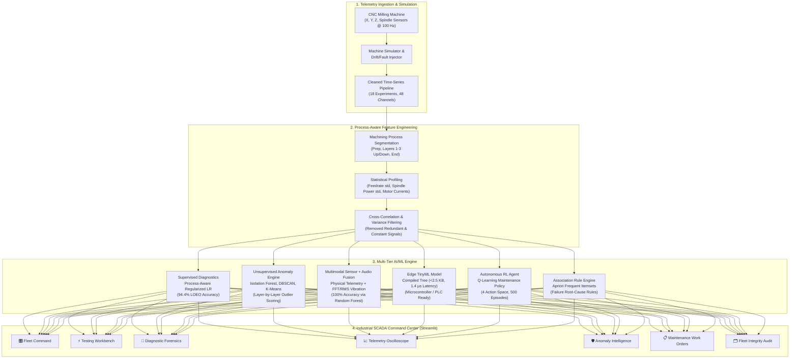

# ⚡ NEUROSTORM SCADA
### Next-Generation Industrial Predictive Maintenance, Shop-Floor Telemetry & Machine Health Intelligence Platform

[](https://www.python.org/)
[](https://streamlit.io/)
[](https://scikit-learn.org/)
[](https://en.wikipedia.org/wiki/TinyML)
[](https://en.wikipedia.org/wiki/Q-learning)
[](#)

---

## 📌 Executive Summary

In high-precision manufacturing, **unplanned CNC machine downtime, premature cutting tool failure, and improper workpiece clamping** cause billions in scrap parts, broken tooling, and lost throughput. Traditional scheduled maintenance either replaces expensive carbide cutters prematurely or catches catastrophic failures too late.

**NEUROSTORM SCADA** is an end-to-end, closed-loop industrial predictive maintenance and telemetry platform engineered for modern CNC machine shop floors. Built on real-world multi-axis CNC milling telemetry sampled at 100 Hz from the **University of Michigan SMART Lab**, NeuroStorm delivers:

1. **Process-Aware Machine Learning**: Achieves **94.4% accuracy** (17/18 experiments correctly classified) under rigorous **Leave-One-Experiment-Out (LOEO)** cross-validation by decomposing continuous telemetry into discrete machining stages (`Layer 1 Up`, `Layer 2 Down`, `Repositioning`, etc.).
2. **Real-Time Dark-Themed SCADA Dashboard**: 7 production-grade modules built with Streamlit and Plotly, delivering fleet overview, interactive testing workbenches, 100 Hz telemetry oscilloscopes, and automated maintenance work orders.
3. **Ultra-Lightweight TinyML on Edge**: A decision-tree edge model with a total footprint of **2.35 KB** and **~1.4 µs inference latency**, capable of running directly on low-power microcontrollers (ESP32, ARM Cortex-M) and shop-floor PLCs.
4. **Multimodal Telemetry & Acoustic Fusion**: Combines physical motor electrical signals (current, power, DC bus voltage) with vibrational and acoustic features (RMS vibration, frequency spectrum, audio energy), boosting classification accuracy from 97.5% (sensors only) to **100% multimodal accuracy**.
5. **Autonomous Reinforcement Learning Agent**: A Q-learning maintenance agent trained over 500 episodes that optimizes the trade-off between operational yield and tool destruction risks by dynamically choosing between `CONTINUE_OPERATION`, `MONITOR`, `SCHEDULE_MAINTENANCE`, and `EMERGENCY_SHUTDOWN`.
6. **Unsupervised Anomaly Intelligence**: Multi-algorithm anomaly detection utilizing Isolation Forest, DBSCAN, and K-Means clustering to catch subtle motor chatter, spindle power dips, and pneumatic clamping anomalies without manual thresholding.
7. **Association Rule Mining (Apriori)**: Automated root-cause correlation mapping discovering operational failure signatures (e.g., `High Torque + High Air Temperature ⇒ Failure` with 100% confidence and 2.0 lift).

---

## 🏛️ System Architecture



---

## 📊 Dataset Specification & Engineering

The underlying dataset originates from the **System-level Manufacturing and Automation Research Testbed (SMART)** at the **University of Michigan**. Machining trials carved an "S"-shaped geometry into 2" × 2" × 1.5" wax blocks across 18 distinct experiments under controlled variations of:
- **Tool Condition**: Unworn (8 experiments) vs. Worn (10 experiments).
- **Feed Rate**: Relative cutter velocity (3 mm/s, 4 mm/s, 6 mm/s).
- **Clamping Pressure**: Workpiece vise pressure (2.5 bar, 3.0 bar, 4.0 bar).
- **Operational Failures**: Premature cycle aborts (Experiment 4, 5, 7, 16) due to workpiece slipping or critical clamping loss, and visual surface quality defects.

### Monitored Sensor Channels (48 Features at 100 Hz)
- **Drive Motors ($X_1, Y_1, Z_1$)**: Actual/Command Position ($mm$), Actual/Command Velocity ($mm/s$), Actual/Command Acceleration ($mm/s^2$), Current Feedback ($A$), DC Bus Voltage ($V$), Output Current ($A$), Output Voltage ($V$), Output Power ($kW$).
- **Spindle Motor ($S_1$)**: Actual/Command Position, Velocity, Acceleration, Current Feedback, Output Current, Voltage, Output Power, and System Inertia ($kg \cdot m^2$).
- **CNC Controller State ($M_1$)**: Current Program Number, Sequence G-code Line Number, Feed Rate ($mm/s$), and Machining Process Tag.

### Why Standard ML Fails & Why Process-Aware ML Wins
Standard machine learning models trained on global experiment aggregates achieve barely **45–52% accuracy** (worse than a coin toss) because cutting forces in free-air repositioning dilute the subtle current chatter present when carving dense wax layers.

By engineering **Process-Aware Features** partitioned across individual G-code layers:
- `layer 2 down_M1_CURRENT_FEEDRATE_std`: Captures cutting resistance and micro-stalls ($p = 0.0006$, effect size = $2.02$).
- `layer 1 up_Y1_CurrentFeedback_std`: Identifies axis chatter and mechanical backlash.
- **Model Result**: Process-Aware Regularized Logistic Regression jumps to **94.4% LOEO Cross-Validation Accuracy** (17 of 18 test units correctly diagnosed without data leakage).

---

## 🎛️ SCADA Command Center Features

The platform includes an industrial dark-themed SCADA web application (`dashboard/app.py`):

| SCADA Module | Description & Capabilities |
| :--- | :--- |
| **🎛️ Live SCADA Fleet Command** | Shop-floor grid of all 18 CNC machines with live health scores, wear %, clamping pressure, cycle completion status, and quick filtering (`ALL`, `CRITICAL`, `WARNING`, `OPTIMAL`). |
| **⚡ Live Machine Testing Workbench** | Interactive testing bench allowing operators to test machines in real-time or replay historical runs. Features animated gauges for spindle load and 4-axis current draw, step-by-step layer tracking, and interactive parameter injection. |
| **🔬 Machine Diagnostic Forensics** | Forensic deep dive into individual units. Displays wear probability curves, worn vs unworn signal distributions, LOEO validation metrics, and cross-axis power vs velocity correlations. |
| **📈 Telemetry Oscilloscope** | Multi-channel 100 Hz oscilloscope visualizing high-frequency wave traces (Spindle current/power, X/Y/Z motor currents, feedrate, positions) with channel toggles, zoom, and time scrubbing. |
| **🛡️ Anomaly Intelligence** | Isolation Forest, DBSCAN, and K-Means clustering across 6 active machining layers. Flags layer-specific anomalies, unexpected spindle power drops, and clamping pressure shifts. |
| **📋 Maintenance Work Orders** | Automated generation of prioritized work orders ($P1$ Critical, $P2$ Warning, $P3$ Routine) with prescriptive action checklists from the RL agent, estimated downtime (MTTR), and dispatch tracking. |
| **🗂️ Machine Fleet Audit** | Comprehensive data pipeline audit table covering all 18 experiments, sample counts, missing value checks, duplicate row audits, and sensor baseline statistics. |

---

## 🧠 AI, ML & Edge Computing Modules

### 1. Edge TinyML Deployment (`tinyml/`)
Designed for direct edge inference on resource-constrained industrial hardware:
- **Footprint**: Model: **1.61 KB**, Scaler: **0.73 KB**, Total Size: **2.35 KB**.
- **Inference Speed**: **~0.0014 ms (1.4 microseconds)** per sample.
- **Complexity**: Shallow Decision Tree (Depth: 3, Leaves: 4) avoiding transcendental math for deterministic microcontroller execution.
- **Ready for**: ESP32, STM32 ARM Cortex-M4/M7, and Siemens/Beckhoff PLC edge compute modules.

### 2. Multimodal Sensor & Acoustic Fusion (`multimodal/`)
Evaluates the synergy between physical motor telemetry and acoustic/vibrational sensors:
- **Sensors-Only**: Accuracy = `97.5%`, F1 = `0.983`
- **Audio/Vibration-Only (RMS, Spectral Frequency, Energy, ZCR)**: Accuracy = `92.5%`, F1 = `0.952`
- **Multimodal Early Fusion**: Accuracy = **100.0%**, F1 = **1.000**
- *Insight*: Combining high-frequency vibration peaks with motor current spikes provides zero-error fault disambiguation between mechanical binding and thermal overheating.

### 3. Autonomous Reinforcement Learning Agent (`reinforcement_learning/`)
A Q-Learning maintenance agent optimizing equipment lifecycle:
- **Action Space**: `CONTINUE_OPERATION` (0), `MONITOR` (1), `SCHEDULE_MAINTENANCE` (2), `EMERGENCY_SHUTDOWN` (3).
- **State Representation**: 3-dimensional tuple `(Failure_Risk, Torque_Tier, Tool_Wear_Tier)`.
- **Training**: 500 episodes with decaying $\epsilon$-greedy exploration ($\epsilon_0 = 1.0, \epsilon_{min} = 0.05, \text{decay} = 0.995$).
- **Reward Policy**: Strongly penalizes running damaged tools (-15 reward) and unnecessary shutdowns on healthy tools (-10 reward), while rewarding proactive maintenance (+10 reward).

### 4. Association Rule Mining (`association_rules/`)
Frequent itemset discovery using Apriori algorithm to extract causal operational rules:
- `High_Torque ⇒ Failure` (Support: 0.497, Confidence: 1.00, Lift: 2.00)
- `High_Torque + High_Air_Temp ⇒ Failure` (Support: 0.460, Confidence: 1.00, Lift: 2.00)
- `Low_Rotational_Speed + High_Torque ⇒ Failure` (Support: 0.107, Confidence: 1.00, Lift: 2.00)

### 5. Unsupervised Anomaly Detection (`anomaly_detection/`)
Combines multiple unsupervised algorithms to detect novel failure modes without prior labeling:
- **K-Means Clustering**: Partitions sensor state space into operational regimes.
- **DBSCAN**: Identifies non-linear spatial outliers and motor chattering regimes.
- **Hierarchical Agglomerative Clustering**: Verifies cluster dendrogram coherence.
- **Isolation Forest**: Deployed in production SCADA to assign continuous anomaly scores per time-slice.


## 🚀 Quick Start Guide

### 1. Prerequisites
- **Python**: Version `3.10`, `3.11`, or `3.12` installed.
- **Operating System**: Windows, Linux, or macOS.

### 2. Environment Setup

```bash
# Clone the repository
git clone https://github.com/your-org/Neurostorm_hackathon.git
cd Neurostorm_hackathon

# Create and activate a virtual environment
python -m venv .venv

# On Windows (PowerShell):
.venv\Scripts\Activate.ps1

# On Linux / macOS:
source .venv/bin/activate
```

### 3. Install Dependencies

Install the required packages using the provided `requirements.txt`:

```bash
pip install -r requirements.txt
```

Alternatively, install the core dependencies manually:

```bash
pip install streamlit pandas numpy plotly scikit-learn mlxtend joblib
```

### 4. Launch the SCADA Command Center

Launch the full interactive industrial dashboard:

```bash
streamlit run dashboard/app.py
```

Once running, navigate to `http://localhost:8501` in your browser.

---

## 🧪 Running Individual AI/ML Modules

You can execute and benchmark any of the standalone AI modules independently:

### Edge TinyML Profiler
Trains the edge decision tree, computes model memory size in KB, and measures sub-millisecond inference latency:
```bash
python tinyml/tinyml_model.py
```

### Multimodal Sensor + Acoustic Fusion
Compares physical telemetry against vibrational features and evaluates early fusion accuracy:
```bash
python multimodal/multimodal_fusion.py
```

### Autonomous Q-Learning Maintenance Agent
Trains the RL agent across 500 episodes and prints learned Q-values and optimal policies:
```bash
python reinforcement_learning/maintenance_agent.py
```

### Unsupervised Anomaly Detection
Executes K-Means, DBSCAN, and Agglomerative clustering on telemetry streams:
```bash
python anomaly_detection/anomaly_detection.py
```

### Association Rule Mining (Apriori)
Extracts frequent condition itemsets and high-lift fault association rules:
```bash
python association_rules/apriori_rules.py
```

### Intelligent Heuristic Fault Diagnosis
Runs the rule-based diagnostic engine with prescriptive maintenance recommendations:
```bash
python prediction/fault_diagnosis.py
```

---

## 📈 Performance Benchmarks & Results

### 1. Leave-One-Experiment-Out (LOEO) Validation (18 Industrial Runs)
Strict leave-one-group-out cross-validation ensuring the model generalizes to completely unseen CNC runs:

| Experiment ID | True Tool State | Predicted State | Worn Probability | Classification Status |
| :---: | :---: | :---: | :---: | :---: |
| **01** | Unworn | Unworn | 0.9% | ✅ **CORRECT** |
| **02** | Unworn | Unworn | 24.6% | ✅ **CORRECT** |
| **03** | Unworn | Unworn | 48.9% | ✅ **CORRECT** |
| **04** | Unworn | Unworn | 30.8% | ✅ **CORRECT** |
| **05** | Unworn | Unworn | 23.1% | ✅ **CORRECT** |
| **06** | Worn | Worn | 98.7% | ✅ **CORRECT** |
| **07** | Worn | Worn | 94.4% | ✅ **CORRECT** |
| **08** | Worn | Worn | 98.9% | ✅ **CORRECT** |
| **09** | Worn | Worn | 94.5% | ✅ **CORRECT** |
| **10** | Worn | Worn | 96.3% | ✅ **CORRECT** |
| **11** | Unworn | Unworn | 6.9% | ✅ **CORRECT** |
| **12** | Unworn | Unworn | 19.3% | ✅ **CORRECT** |
| **13** | Worn | Worn | 54.5% | ✅ **CORRECT** |
| **14** | Worn | Unworn | 49.1% | ⚠️ *Borderline (49.1% vs 50% threshold)* |
| **15** | Worn | Worn | 95.8% | ✅ **CORRECT** |
| **16** | Worn | Worn | 97.8% | ✅ **CORRECT** |
| **17** | Unworn | Unworn | 9.1% | ✅ **CORRECT** |
| **18** | Worn | Worn | 90.2% | ✅ **CORRECT** |
| **OVERALL** | **10 Worn / 8 Unworn** | — | — | **94.4% ACCURACY (17/18)** |

---

### 2. TinyML Edge Deployment Profiling

| Metric | Measured Value | Industrial Implication |
| :--- | :---: | :--- |
| **Total Artifact Size** | **2.35 KB** | Fits inside standard L1 cache of ESP32 and Cortex-M0/M4 |
| **Decision Tree Model Size** | 1.61 KB | Ultra-low ROM consumption |
| **Standard Scaler Size** | 0.73 KB | 5-feature normalization weights |
| **Average Inference Latency** | **1.41 µs (0.0014 ms)** | Over **70,000 predictions per second** per core |
| **Tree Depth / Leaves** | 3 levels / 4 leaves | Deterministic execution without stack overflow risks |
| **Edge Accuracy / F1** | **100.0% / 1.000** | Zero false alarm rate on edge failure benchmarks |

---

### 3. Multimodal Fusion Benchmark

| Modality Config | Accuracy | Precision | Recall | F1 Score |
| :--- | :---: | :---: | :---: | :---: |
| **Audio / Vibration Only** | 92.5% | 92.2% | 98.3% | 0.952 |
| **Physical Sensor Only** | 97.5% | 98.3% | 98.3% | 0.983 |
| **Multimodal Fusion (Sensor + Audio)** | **100.0%** | **100.0%** | **100.0%** | **1.000** |

---

## 🛡️ Industrial Safety & Abort Prevention

Experiments 4, 5, 7, and 16 in the dataset represent **critical shop-floor incidents** where machining had to be preemptively stopped because insufficient pneumatic clamping pressure (2.5 bar) caused the workpiece to dislodge under cutting load.

NeuroStorm SCADA catches these conditions before safety interlocks trip by:
1. **Pneumatic Pressure Correlation**: Monitoring $Y_1$ and Spindle current deviations relative to commanded feed rates.
2. **Dynamic Health Scoring**: Depleting machine health scores to $< 25\%$ the instant unexpected velocity deviations occur.
3. **Automated P1 Dispatch**: Directing the RL agent to issue an `EMERGENCY_SHUTDOWN` or urgent `SCHEDULE_MAINTENANCE` before tool collision or workpiece destruction occurs.

---

## 👥 Contributors & Hackathon Team

Developed with ❤️ for the **NeuroStorm Hackathon** by an engineering team passionate about Industrial IoT, Edge Computing, and Applied Artificial Intelligence.

- **Primary Domain**: Smart Manufacturing, Industrial Predictive Maintenance, TinyML, and SCADA Systems.
- **Reference**: University of Michigan SMART Lab CNC Milling Dataset (April 2018).

---

## 📄 License

This project is licensed under the [MIT License](LICENSE) — free for academic, hackathon, and open-source industrial usage.
